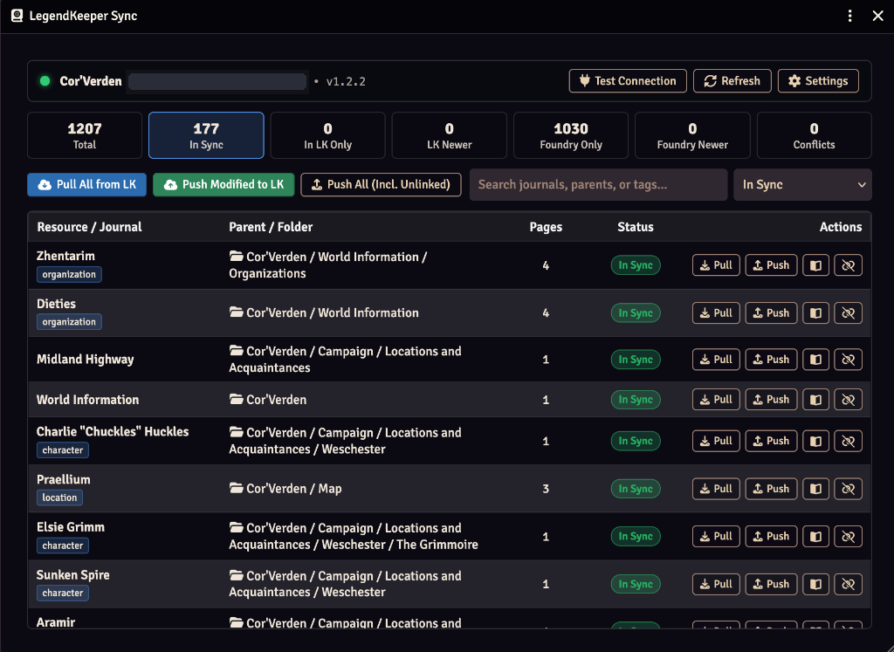
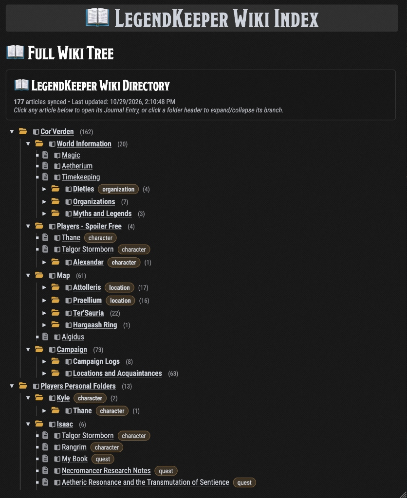
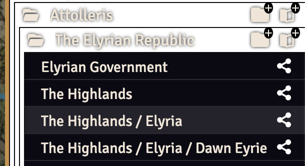

# LegendKeeper Journal Sync for Foundry VTT

A Foundry VTT (v12 / v13) module that provides **two-way synchronization** between your **LegendKeeper** worldbuilding project and **Foundry VTT Journal Entries** using the official **LegendKeeper v3 REST API**.

> [!NOTE]
> **Project Status & Authorship**
> I made this module for my own table and am sharing it in case it helps other GMs! It was mostly authored by **Gemini 4 Argon**.
>
> Because I built this primarily for personal use, **I cannot guarantee ongoing support or updates**, though you are always free to reach out to me or open a GitHub issue if you run into trouble. **You are very welcome (and encouraged!) to fork, modify, and improve this module.**

---

## Screenshots

### LegendKeeper Sync Manager Dashboard


### Auto-Generated `📖 LegendKeeper Wiki Index` Journal


---

## Features

- **Two-Way Sync (Pull & Push) with Conflict Resolution**:
  - **Pull from LegendKeeper → Foundry VTT**: Imports LegendKeeper Resources as Foundry `JournalEntry` documents and their Document tabs (`Main`, sub-pages, maps, timelines) as `JournalEntryPage`s.
  - **Push from Foundry VTT → LegendKeeper**: Creates or updates LegendKeeper Resources and Document tabs from your Foundry `JournalEntry` and `JournalEntryPage` content using optimistic concurrency (`If-Match` block versioning).
  - **Safe Pre-Push Check & Interactive Conflict Dialog**: Before pushing changes to LegendKeeper, the module automatically checks LegendKeeper's latest version. If only other pages changed remotely, they are pulled first automatically; if the **same page** was edited in both Foundry and LegendKeeper since the last sync, a side-by-side **Conflict Resolution Dialog** lets you choose whether to keep the **Foundry Version** or the **LegendKeeper Version**.
- **Rich Block & HTML Conversion**:
  - Converts LegendKeeper headings, paragraphs, inline formatting (`bold`, `italic`, `underline`, `strike`, `code`, `sub`, `sup`, links), bullet/numbered lists, task checklists, tables, callouts (`info`, `note`, `success`, `warning`, `error`, `custom`), collapsible `expand` sections (`<details>`), multi-column layouts, key-value blocks, meters, infoboxes, and sidebar properties.
  - **Cross-Document Mentions**: Converts LegendKeeper `mention` runs and `resourceLink`/`resourceCollection` blocks into native clickable Foundry `@UUID[JournalEntry...]` links on pull, and converts Foundry `@UUID[JournalEntry...]` links back into native LegendKeeper `mention` runs on push.
- **Secret & Hidden Resource Support (Player vs. GM Permissions)**:
  - Non-hidden LegendKeeper articles (and the **`📖 LegendKeeper Wiki Index`**) are automatically imported with **All Players: Observer** permission so your players can browse the wiki right away.
  - Resources or folders marked **Hidden** in LegendKeeper (including any child articles inside a hidden folder) are imported as **GM-Only** (`All Players: None`) and wrapped in GM-only `<section class="secret">` blocks inside the Wiki Index tree, or skipped completely based on your settings.
  - Converts LegendKeeper `secret` blocks into Foundry `<section class="secret">` blocks (GM-only with a reveal/hide toggle) or strips them on pull (while preserving them in LegendKeeper when pushing back).
- **3 Configurable Organization Modes (4-Level Depth Workaround)**:
  - **Mode 1: Single Master Journal Entry *(Default & Recommended)***: Places the entire LegendKeeper wiki inside a single **`📖 LegendKeeper Wiki`** `JournalEntry`. Page 1 is the interactive **`📖 Wiki Directory`** tree, every article is a `JournalEntryPage` organized in a collapsible multi-level folder tree in the left-hand sidebar (with unlimited indentation depth and `▾ 📂` folder toggles), and multi-tab articles render all of their tabs inline separated by horizontal dividers.
  - **Mode 2: Single Top-Level Folder + Wiki Index**: Places **`📖 LegendKeeper Wiki Index`** and one `JournalEntry` per article (with clean titles) inside the single `LegendKeeper` folder.
  - **Mode 3: Nested Folders (up to Foundry's 4-Level Limit) + Path Names Below + Wiki Index**: Creates real Foundry folders up to depth 4 and prefixes deeper articles with their remaining subfolder path (`Subfolder / Article Name`).
- **Interactive Sync Manager UI**:
  - Accessible from the **Journal Directory** sidebar (**LegendKeeper Sync** button) or **Module Settings**.
  - Displays live sync statuses (`In Sync`, `In LK Only`, `LK Newer`, `Foundry Only`, `Foundry Newer`, `Conflict`) with search, status filters, bulk Pull/Push actions, and per-entry Pull/Push/Open/Unlink controls.
  - Quick **LK Pull** and **LK Push** buttons in the header of every open Journal Entry sheet.

---

## Installation

### Option 1: Install via Manifest URL in Foundry VTT
1. In Foundry VTT's **Add-on Modules** tab, click **Install Module**.
2. Paste the following **Manifest URL** at the bottom of the window and click **Install**:
   ```text
   https://raw.githubusercontent.com/AudXT/LegendKeeperFoundryLink/main/module.json
   ```
3. Launch your World and enable **LegendKeeper Journal Sync** under **Manage Modules**.

### Option 2: Manual / Clone Installation
1. Clone or copy this repository into your Foundry VTT `Data/modules/legendkeeper-foundry-sync` directory:
   ```bash
   git clone https://github.com/AudXT/LegendKeeperFoundryLink.git "<FoundryData>/Data/modules/legendkeeper-foundry-sync"
   ```
2. Launch Foundry VTT, open your World, and enable **LegendKeeper Journal Sync** under **Manage Modules**.

---

## Setup & CORS Proxy Configuration

### Step 1: Generate a LegendKeeper API Key
1. In LegendKeeper, open your project and navigate to **Project Settings → Developers → API Keys**.
2. Create an API key with the **Admin** role (recommended so the key can create/update top-level resources and read hidden content) and copy the `lk_...` secret.
3. In Foundry VTT, go to **Game Settings → Configure Settings → LegendKeeper Journal Sync** and paste your `lk_...` key into **LegendKeeper API Key**.

### Step 2: Configure the CORS Proxy
LegendKeeper's v3 REST API does not include browser `Access-Control-Allow-Origin` (CORS) headers on `OPTIONS` preflight requests. Because Foundry VTT modules make API calls directly from the user's web browser, requests must pass through a lightweight CORS proxy that adds CORS headers and forwards requests to `https://www.legendkeeper.com`.

You have **two ways** to run this proxy:

#### Option A (Recommended): Free Cloudflare Worker (One-Time Setup, Works Anywhere)
Setting up a free Cloudflare Worker takes about 1 minute, requires zero maintenance, stores no secrets or API keys (your `lk_...` header simply passes through over HTTPS), and works from **any computer, network, or remote player/GM session** without needing a terminal running on your server.

1. Sign in or create a free account at [https://dash.cloudflare.com](https://dash.cloudflare.com).
2. In the left sidebar, go to **Compute (Workers) → Workers & Pages** and click **Create**.
3. Click **Start with Hello World!** (or **Create Worker**) and click **Deploy** (Cloudflare will assign a URL like `https://<worker-name>.<your-subdomain>.workers.dev`).
4. Click **Edit code** in the top-right corner of the Worker page.
5. Delete the template code in `worker.js`, paste the entire contents of [`tools/cloudflare-worker.js`](tools/cloudflare-worker.js) from this repository, and click **Deploy** in the top-right corner.
6. Copy your Worker URL (e.g. `https://falling-base-1b54.<your-subdomain>.workers.dev`) and paste it into **Foundry VTT → Configure Settings → LegendKeeper Journal Sync → API Base URL / CORS Proxy**.

#### Option B (Alternative): Local / Self-Hosted Node.js Proxy (`tools/lk-cors-proxy.mjs`)
If you prefer to run a local proxy on your own computer or home server without Cloudflare, a zero-dependency Node.js script is included in [`tools/lk-cors-proxy.mjs`](tools/lk-cors-proxy.mjs).

1. Run the proxy on a machine with Node.js (v18+):
   ```bash
   node tools/lk-cors-proxy.mjs
   ```
   By default it listens on `http://0.0.0.0:8787` (you can customize the port with `LK_PROXY_PORT=8787 node tools/lk-cors-proxy.mjs`).
2. To keep it running in the background on a home server, you can use `pm2`:
   ```bash
   npm install -g pm2
   pm2 start tools/lk-cors-proxy.mjs --name lk-cors-proxy
   pm2 save
   pm2 startup
   ```
3. Set **API Base URL / CORS Proxy** in Foundry Module Settings to:
   - `http://localhost:8787` (if running the proxy on the same PC as your browser), or
   - `http://<your-server-lan-ip>:8787` (if running on a home server on the same local network).
   - *Note*: If you access your Foundry server remotely over **HTTPS** (e.g., via a domain name or Cloudflare Tunnel), modern browsers block plain `http://` LAN requests as "Mixed Content". For remote/HTTPS access, either use **Option A (Cloudflare Worker)** above or expose the local proxy over HTTPS via your reverse proxy / Cloudflare Tunnel.

---

## Foundry VTT Folder Depth Limitation & Workaround

### The Limitation
LegendKeeper allows you to nest articles and folders to **unlimited depth**. However, Foundry VTT enforces a strict engine-level limit of **4 nested folder levels** (`CONST.FOLDER_MAX_DEPTH = 4`) for `JournalEntry` folders. Attempting to create a 5th folder level in Foundry VTT fails with the server error:
> *"JournalEntry Folders may only be nested 4 levels deep"*

### How This Module Works Around It
In **Module Settings → Journal & Folder Organization Mode**, you can choose between **three ways** to organize your LegendKeeper wiki in Foundry VTT (and switching between modes automatically migrates and cleans up the previous layout on your next pull):

1. **Single Master Journal Entry — Entire Wiki as Pages in One `📖 LegendKeeper Wiki` Journal *(Default & Recommended)***:
   - Consolidates your entire LegendKeeper project into a **single** **`📖 LegendKeeper Wiki`** `JournalEntry` inside the `LegendKeeper` folder—keeping your Foundry Journal sidebar clean and minimizing world document overhead.
   - **Page 1 (`📖 Wiki Directory`)** is a full collapsible tree of your entire LegendKeeper project with article counts, tag pills, and direct page links.
   - **Multi-Level Collapsible Sidebar Tree**: Every LegendKeeper resource is a `JournalEntryPage` in depth-first tree order. The left-hand page directory sidebar is enhanced to support **unlimited indentation depth** (`depth 0, 1, 2, 3, 4, 5, 6+`), gold folder icons (`▾ 📂`) with clickable collapse/expand toggles for parent folders, and `└` branch markers for child articles.
   - **Inline Multi-Tab Rendering**: When a LegendKeeper resource has multiple document tabs, all of its tabs are rendered inline inside that resource's single page separated by styled horizontal dividers (`<hr class="lk-tab-hr" />`) and tab headings, while still syncing back to their individual LegendKeeper tabs on push.
   - **Full Clickable Breadcrumb Paths**: Nested pages display a clickable ancestor breadcrumb trail (`Path: Cor'Verden › Map › Attolleris › ...`) at the top of the page and a `Sub-Resources` list at the bottom.
2. **Single Top-Level Folder + Wiki Index (One Journal Entry per Article)**:
   - All synced LegendKeeper articles are placed inside a single top-level **`LegendKeeper`** folder with their clean article titles, alongside a pinned **`📖 LegendKeeper Wiki Index`** Journal Entry at the top.
   - The **`📖 LegendKeeper Wiki Index`** displays your full LegendKeeper hierarchy to **unlimited depth** using collapsible `<details>` folder trees, article counts, tag pills, and clickable links.
3. **Nested Folders (up to Foundry's 4-Level Limit) + Path Names Below + Wiki Index**:
   - Creates real Foundry folders up to depth 4 (`LegendKeeper` [1] → `Top Folder` [2] → `Subfolder` [3] → `Sub-subfolder` [4]).
   - Articles deeper than the 4th folder level are placed inside their 4th-level ancestor folder and prefixed with their remaining relative subfolder path (`Subfolder A / Subfolder B / Article Name`), while preserving their true unprefixed title when pushing back to LegendKeeper.

   

---

## Scripting / Macro API

The module exposes its API at `game.modules.get("legendkeeper-foundry-sync").api`:

```js
const lkApi = game.modules.get("legendkeeper-foundry-sync").api;

// Open the Sync Manager UI
lkApi.openSyncManager();

// Pull all resources from LegendKeeper
await lkApi.pullAll();

// Pull a specific LegendKeeper resource by ID
await lkApi.pullResource("r0123456789abcdefghijklm");

// Push a specific Foundry JournalEntry to LegendKeeper
const entry = game.journal.getName("Waterdeep Overview");
await lkApi.pushJournal(entry);
```

---

## Author Note, Support & Forking

- **Authorship**: This module was mostly authored by **Gemini 4 Argon**, created for personal use and shared publicly for the community.
- **Support**: I cannot guarantee ongoing maintenance or support for this module, as I built it for my own campaign setup. However, you are very welcome to open an issue or reach out to me if you run into problems or have questions!
- **Forks & Contributions**: Please feel free to **fork this repository**, customize it for your own setup, or build upon it and share your improvements with others.
